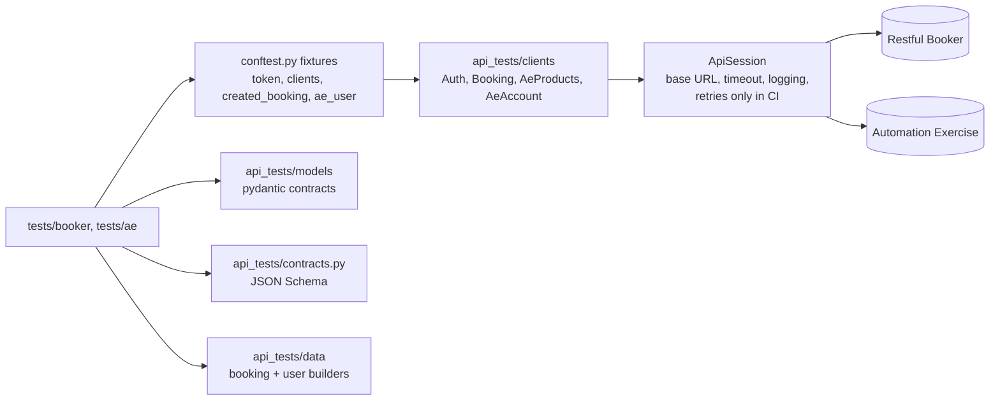
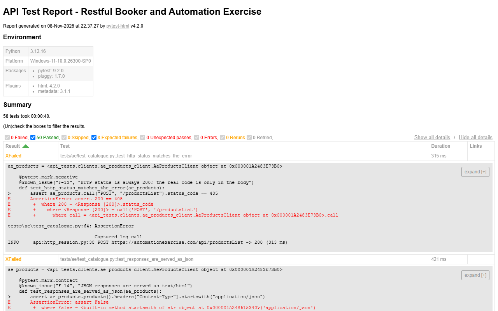

# API Automation with pytest

API test automation in Python for two public practice APIs — Restful Booker and Automation Exercise — with
one client per resource, typed contracts (pydantic) and JSON-schema checks, fixtures for authentication and
self-cleaning test data, and an HTML report published by GitHub Actions.

[](https://github.com/the-sudipta/api-automation-pytest/actions/workflows/api-tests.yml)
[](https://the-sudipta.github.io/api-automation-pytest/)
[](LICENSE)

## What this project shows

- I build a small, readable **API test framework** in Python: settings from `.env`, a shared HTTP session,
  one client per resource, and tests that only talk to clients.
- **Contract testing** two ways: strict pydantic models *and* JSON Schema with `$ref` between files.
- A full **CRUD chain** (create → read → PUT → PATCH → delete → 404), **negative and boundary** tests and
  **parametrized** data.
- **Fixtures** handle the token and create/delete test data, so every test is independent.
- **Known API defects are explicit**: strict `xfail` with a link to the finding, so a fix turns into a failing
  "XPASS" that reminds me to retest.

## Systems under test

| API | Docs | Covered |
|---|---|---|
| Restful Booker | https://restful-booker.herokuapp.com/apidoc | `/auth`, `/booking` list + filters, get, create, PUT, PATCH, DELETE, cookie token and Basic auth |
| Automation Exercise | https://automationexercise.com/api_list | APIs 1–14: products, brands, search, unsupported methods, verify login, create / update / read / delete account |

Public practice APIs only; fake data (`@example.com` addresses, random names); every booking and account a
test creates is deleted by its fixture.

## Tech stack

Python 3.12 (uv) · pytest · requests · pydantic v2 · jsonschema · python-dotenv · pytest-html · ruff ·
GitHub Actions + Pages

## Architecture



## Project structure

```
api-automation-pytest/
├─ api_tests/
│  ├─ settings.py          # env / .env settings
│  ├─ http_session.py      # requests Session: base URL, timeout, logging, CI-only retries
│  ├─ clients/             # auth_client, booking_client, ae_products_client, ae_account_client
│  ├─ models/              # pydantic: booking.py, automation_exercise.py
│  ├─ schemas/             # JSON Schema: booking, created_booking ($ref), booking_ids
│  ├─ contracts.py         # schema validation helper
│  └─ data/                # bookings.py, users.py (fake data builders)
├─ tests/
│  ├─ conftest.py          # fixtures + known_issue() marker
│  ├─ booker/              # test_auth, test_booking_crud, test_booking_filters, test_booking_negative, test_booking_contract
│  └─ ae/                  # test_catalogue, test_account
└─ .github/workflows/api-tests.yml
```

## How to run

**Windows (PowerShell)**
```powershell
powershell -ExecutionPolicy Bypass -File scripts\setup.ps1   # uv (if missing), Python 3.12, packages
uv run pytest                                  # all tests
uv run pytest -m smoke                         # smoke only
uv run pytest -m "booker and negative" -v      # one area
uv run pytest --html=reports/index.html --self-contained-html
```
Copy `.env.example` to `.env` to point the tests at another environment.

**CI:** `.github/workflows/api-tests.yml` runs ruff and the suite on push, pull request and nightly, uploads
the HTML and JUnit reports and publishes the HTML report to Pages. Because GitHub sets `CI=true`, the session
retries gateway errors (502/503/504) on idempotent requests — locally there are no retries.

## Test coverage summary

| Area | Tests |
|---|---|
| Restful Booker — auth (valid, 4 invalid credentials, status code) | 6 |
| Restful Booker — CRUD chain incl. Basic auth | 6 |
| Restful Booker — filters | 3 |
| Restful Booker — negative and boundary (tokens, unknown IDs, malformed JSON, prices, validation) | 16 |
| Restful Booker — contract (pydantic + JSON Schema + headers, schema self-check) | 5 |
| Automation Exercise — catalogue, search, unsupported methods, contract | 13 |
| Automation Exercise — account lifecycle and login | 9 |
| **Total** | **58** — last run: **50 passed, 8 xfailed** (known defects) |

### Known API defects (strict `xfail`)

| Finding | Test |
|---|---|
| F-01 wrong credentials return 200, not 401 | `test_should_answer_401_for_wrong_password` |
| F-05 missing `firstname` returns 500, not 400 | `test_should_answer_400_when_firstname_is_missing` |
| F-06 text price stored as `null` | `test_should_reject_price_as_text` |
| F-07 negative price accepted | `test_should_reject_negative_price` |
| F-08 check-out before check-in accepted | `test_should_reject_checkout_before_checkin` |
| F-09 invalid date stored as `0NaN-aN-aN` | `test_should_reject_invalid_date` |
| F-13 Automation Exercise: HTTP status always 200 | `test_http_status_matches_the_error` |
| F-14 Automation Exercise: JSON served as `text/html` | `test_responses_are_served_as_json` |

The findings, with raw evidence, are documented in my
[Postman project](https://github.com/the-sudipta/api-testing-postman-newman/blob/main/docs/findings.md).

## Report

Live: https://the-sudipta.github.io/api-automation-pytest/



## Design decisions and what I would do next

- **Clients return raw responses.** Deciding what is correct is the test's job; the client never asserts.
- **Two contract layers.** pydantic gives typed objects for readable assertions; JSON Schema is the
  language-neutral contract a backend team can share.
- **Strict `xfail` for known defects** instead of skipping or deleting tests.
- Next: generate the schemas from an OpenAPI file and add a mock server for offline runs.

## Author

**Sudipta Kumar Das** — Junior SQA Engineer (manual, API, automation) · [GitHub](https://github.com/the-sudipta)

Copyright © 2026 Sudipta Kumar Das. All rights reserved — see [LICENSE](LICENSE).
